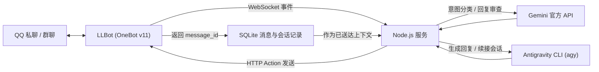

# OneBot QQ Bot (Standalone)

写在前面的人话：本来使用的qqbot是openclaw+本地反代agy的做法，但是agy已经封了我两个账号理由都是反代。所以想到了直接改造原生agy作为qqbot后端的想法，实现了和之前 https://github.com/kiddy-he/elysia_bot-openclaw 一样的效果。可能不能直接使用，但是交给你的agent参考一下改造思路是可以的，这种方案我估计不容易被封，如果还是被封了我会在这里告知。

最后：
哈吉米王朝了

以下由argon与astra联合编写：

这是一个基于 Node.js 的 QQ 机器人服务，通过 OneBot v11 协议对接 LLBot，支持私聊和群聊。它可以独立运行在 Linux 主机上，不需要额外部署 OpenClaw 网关。

在模型分工上，日常对话正文由本地的 Antigravity CLI（`agy`）通过 ACP 会话生成；意图分类、回复审查和异常兜底等轻量任务则走 Gemini 官方 HTTP API。权限控制、角色工作区、定时任务和消息回执都由本服务统一管理。



## 环境要求与本地测试

- **基础运行环境**：Linux、Node.js `>= 24.15`
- **完整功能与联调依赖**：Python `>= 3.10`、可执行的用户命名空间沙箱 `/usr/bin/bwrap`，以及用于登录锁管理的 `/usr/bin/flock`

在仓库根目录下安装依赖并运行单元测试：

```sh
npm ci
npm test
```

如果想验证完整链路，可以单独运行端到端测试：

```sh
npm run test:host
```

`test:host` 不需要真实的 QQ 号或 API 密钥。它会在临时目录里跑通完整的初始化流程，在本地启动模拟的双账号 LLBot 服务、Gemini HTTP 接口以及测试用的 ACP 进程，验证私聊、群聊、重复消息过滤、回执落库和同一私聊会话的多轮续接。

## 快速开始

### 1. 准备 LLBot 与 Antigravity CLI

1. 为机器人 QQ 配置好 LLBot，开启正向 OneBot v11 WebSocket 和 HTTP 服务，并为两个端口设置相同的访问令牌（Access Token）。
2. 在运行本服务的 Linux 用户下安装 Antigravity CLI（`agy`）并完成登录，记下账号可用的模型 ID。服务默认查找 `~/.local/bin/agy`，如果安装在其他位置，可通过环境变量 `ONEBOT_AGY_BIN` 指定绝对路径。

### 2. 填写账号并初始化配置目录

复制 [`examples/accounts.example.json`](examples/accounts.example.json) 到本地并按实际情况修改：

- 填入机器人 QQ（`selfId`）、允许私聊的管理员 QQ（`privateAdminIds`）、启用的群号（`groupIds`）、LLBot 地址以及模型 ID。**所有 QQ 号和群号都必须写成 JSON 字符串**。
- 单账号固定使用 `"id": "default"`。如果需要同时挂第二个 QQ 号，可以在 `accounts` 数组里再加一项，`"id"` 固定填 `"yuexia"`，并配置独立的 LLBot 端口和 `tokenEnv` 变量名。
- 如果你有可用的官方 Decisions 模型，可以在配置顶层加上 `"decisionModel"` 字段；服务会优先用它做前置意图判断，未命中时再回退到常规的意图分类模型。

填写完成后，执行 `npm run init` 生成运行配置目录（目标目录必须尚未存在）：

```sh
cp examples/accounts.example.json accounts.local.json
# 编辑 accounts.local.json 填入你的账号和模型信息
export ONEBOT_CONFIG_ROOT="$HOME/.config/onebot-qq"
npm run init -- accounts.local.json "$ONEBOT_CONFIG_ROOT"
```

初始化脚本会在 `$ONEBOT_CONFIG_ROOT` 下生成角色工作区（`workspaces/`）、模型路由、权限策略和工具执行器配置。同一个机器人账号下的多位私聊管理员共用该账号的角色设定（`SOUL.md`），但各自的对话上下文彼此隔离。

### 3. 启动服务

把 `GEMINI_API_KEY` 以及账号配置里 `tokenEnv` 对应的环境变量传入进程即可启动。下面用 `read -rsp` 交互输入，避免把密钥留在 shell 历史里（如果配了双账号，记得一并导出第二个账号的令牌变量）：

```bash
read -rsp 'Gemini API key: ' GEMINI_API_KEY && echo
read -rsp 'OneBot access token: ' ONEBOT_ACCESS_TOKEN && echo
export GEMINI_API_KEY ONEBOT_ACCESS_TOKEN
npm start
```

生产环境推荐使用用户级 systemd 托管。可以参考 [`examples/onebot-qq.service`](examples/onebot-qq.service)，把里面的工作目录和 Node.js 路径改成你机器上的实际位置，并将密钥写入 `EnvironmentFile` 指向的私有环境文件。

## 模型路由与默认权限

初始化后的默认策略是最小权限：只对列表里的管理员和群开放基础对话、引用回复和重置会话，且群聊必须 `@` 机器人才会响应。所有扩展业务工具和定时任务默认全部关闭。

各个子任务（如回复生成、意图分类、内容审查、图片摘要等）具体调哪个模型、超时多久、何时触发降级，都在运行目录的 `onebot-ai.json` 中按任务独立定义。生成的初始配置只包含一个 CLI 模型和一个官方 API 模型，需要精细调整时可对照 [`src/src/ai/router.js`](src/src/ai/router.js) 与 [`config/ai-routing.schema.json`](config/ai-routing.schema.json) 修改。

## 目录结构

运行期的 SQLite 数据库、聊天记录、工作区和缓存媒体全部存放在 `ONEBOT_CONFIG_ROOT` 中，与代码仓库分离，方便日常升级代码：

| 路径 | 说明 |
|---|---|
| `scripts/standalone-onebot.mjs`、`src/src/standalone/` | 服务启动入口、Agent 调度、本地 Unix 控制接口、定时任务与会话记录 |
| `src/src/gateway.js`、`src/src/workspaces/` | OneBot 事件接入、私聊/群聊分发、角色工作区与群成员会话隔离 |
| `src/src/ai/` | `agy` ACP 客户端、多模型任务路由、短期工具桥接、CLI 会话状态管理 |
| `src/src/access/`、`src/src/features/`、`src/src/delivery/` | 权限校验、操作审批、对话提醒、业务工具集与消息投递队列 |
| `src/src/xhs/`、`integrations/` | 小红书、X (Twitter)、B 站动态/直播推送、Agent Reach、ALAS、群股市等扩展模块 |
| `examples/`、`tests/` | 配置与 systemd 模板、端到端模拟测试及各模块单元测试 |

更详细的内部运行机制与扩展接入方法，请查阅：

- [消息流与状态存储](docs/message-flows.md)：单轮对话处理、CLI 会话一致性机制、定时投递流程及 SQLite 库文件说明。
- [可选功能集成](docs/integrations.md)：如何开启 B 站推送、X 媒体解析、小红书、群股市、语音转写等扩展能力。

## 许可证与致谢

本项目主体遵循上游 [openclaw-onebot](https://github.com/xucheng/openclaw-onebot) 的 [MIT 许可证](LICENSE)。小红书模块与群股市插件保留各自原作者的 MIT 授权声明（详见 [`src/src/xhs/NOTICE`](src/src/xhs/NOTICE) 和 [`integrations/sharemarket/astrbot_plugin_sharemarket/LICENSE`](integrations/sharemarket/astrbot_plugin_sharemarket/LICENSE)）。

LLBot、Antigravity CLI、本地语音/绘图模型权重以及角色设定素材不包含在本仓库内，需由部署者自行获取。
