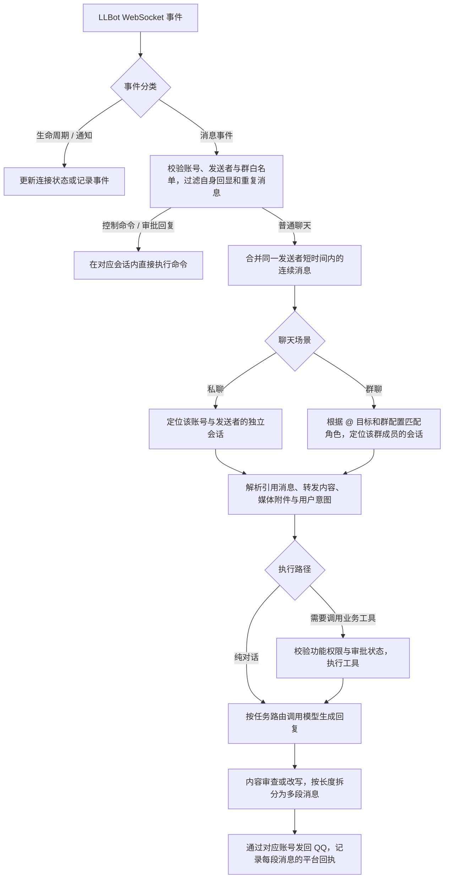
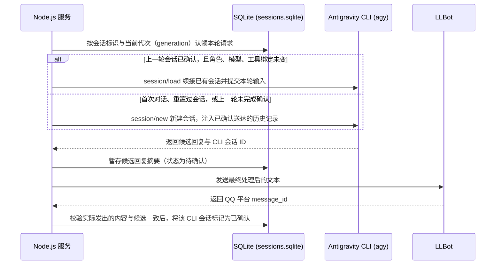
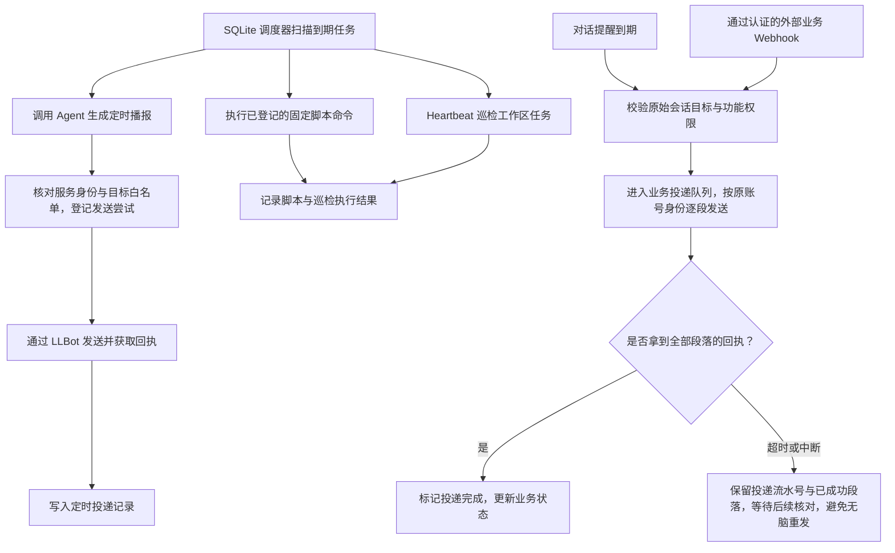

# 消息流与状态存储

本文档说明一条 QQ 消息从进入服务到完成回复的内部流程、Antigravity CLI 会话的续接机制，以及定时任务与异步推送如何保证投递一致性。

## 1. 消息接收与回复流程

在消息预处理和媒体发送阶段，有几个关键的安全与边界限制：

- **引用消息**（[`src/src/quoted-message.js`](../src/src/quoted-message.js)）：收到带引用的消息时，会调用 OneBot `get_msg` 拉取原消息，并核对原消息是否属于当前会话，防止跨会话读取。
- **合并转发**（[`src/src/forwarded-message.js`](../src/src/forwarded-message.js)）：调用 `get_forward_msg` 展开转发卡片时，会严格限制展开的条数、嵌套深度和总文本体积，避免被超长转发撑爆上下文。
- **语音与附件权限**（[`src/src/gateway.js`](../src/src/gateway.js)、[`src/src/standalone/channel-runtime.js`](../src/src/standalone/channel-runtime.js)）：入站语音校验通过后会交给本地 Whisper 转写；机器人向外发送图片、语音或业务文件前，都会校验文件来源是否已获授权。

## 2. CLI 会话续接与上下文一致性

Antigravity CLI（`agy`）自带原生会话记忆（通过 ACP 的 `session/new` 和 `session/load` 管理）。但机器人实际发到 QQ 上的内容，可能会因为审查改写、CLI 故障降级到备用 API、或者 LLBot 发送失败而与 CLI 自己记住的内容不一致。

为了防止 CLI 的内部记忆和 QQ 里的真实聊天记录脱节，服务采用了**收到回执后再确认（Confirm-on-Receipt）**的机制（见 [`src/src/ai/antigravity-chat.js`](../src/src/ai/antigravity-chat.js) 与 [`src/src/ai/antigravity-sessions.js`](../src/src/ai/antigravity-sessions.js)）：

只要中间发生了回复改写、走了备用模型、或者没有拿到完整的发送回执，该轮 CLI 会话就不会被标记为“已确认”。到了下一轮对话，服务会自动开启一个全新的 CLI 会话，并用 SQLite 里**真正成功发到 QQ 上**的历史消息重新构建上下文。

## 3. 定时任务与异步业务投递

除了被动回复消息，服务还负责定时公告、对话提醒以及外部 Webhook（如 B 站动态推送）的主动投递（见 [`src/src/standalone/cron.js`](../src/src/standalone/cron.js)、[`src/src/delivery/queue.js`](../src/src/delivery/queue.js)、[`src/src/features/reminders.js`](../src/src/features/reminders.js)）：

## 4. 运行期 SQLite 数据库一览

所有运行状态都保存在 `$ONEBOT_CONFIG_ROOT/state/` 目录下，按职责拆分为多个 SQLite 文件：

| 相对路径 | 用途 |
|---|---|
| `state/standalone/transcript.sqlite` | 保存 QQ 私聊与群聊的实际收发消息记录（用于重建上下文） |
| `state/antigravity/sessions.sqlite` | 维护 QQ 会话到 `agy` 原生会话 ID 的映射、代次（generation）及确认状态 |
| `state/standalone/schedules.sqlite` | 定时任务定义、触发时间与任务认领锁 |
| `state/business/cron-delivery.sqlite` | 定时播报的每次发送尝试与 LLBot 平台回执记录 |
| `state/business/operations.sqlite` | 业务工具执行记录、高危操作审批单、对话提醒以及异步分段投递队列 |
